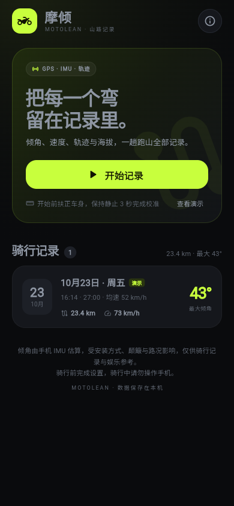
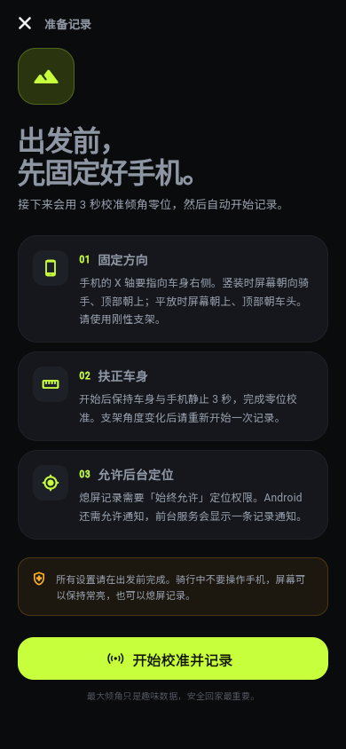
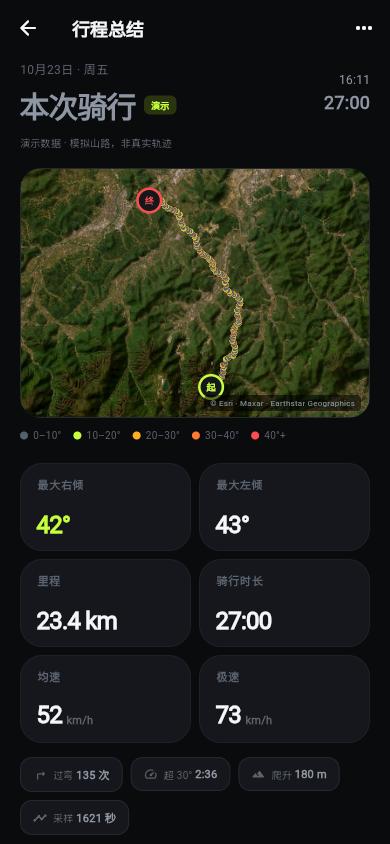
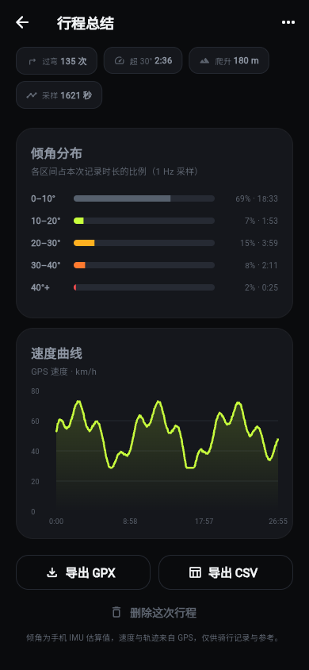

# 摩倾 MotoLean

记录摩托车跑山时的**倾角、速度、轨迹与海拔**。手机固定在车上，3 秒校准后即可熄屏记录，结束后查看按倾角着色的轨迹、倾角分布和速度曲线，并导出 GPX / CSV。

这是面向个人使用的离线原型：没有账号、没有云端。手机端数据保存在本机 SQLite，Web 预览使用内存存储。

## 界面预览

| 首页 | 记录前 |
| --- | --- |
|  |  |

| 行程总结 | 数据详情 |
| --- | --- |
|  |  |

> 截图为浏览器预览生成，路线与数据来自内置演示行程（合成数据）。

## 功能

- 实时速度、左右倾角表盘、实时轨迹地图
- 3 秒静止校准，自动识别手机是竖装还是平放
- 加速度计 + 陀螺仪互补滤波，记录 50 Hz 倾角、1 Hz 行程采样
- 行程总结：左右最大倾角、里程、时长、均速/极速、爬升、过弯次数、倾角分布、速度曲线
- 轨迹按倾角区间着色（0–10° / 10–20° / 20–30° / 30–40° / 40°+）
- GPX（含速度与倾角扩展）与 CSV 导出，走系统分享面板
- 首页内置一条**模拟演示行程**，没有真机也能先看完整效果
- Android 前台服务 + 通知、iOS 后台定位，支持熄屏记录

## 运行

环境：Flutter 3.47.7 / Dart 3.13.5、Xcode 26.3（iOS 26.2 SDK）、CocoaPods 1.17，真机运行。

```bash
flutter pub get
flutter run
```

- iOS：`cd ios && pod install`，用 Xcode 打开 `ios/Runner.xcworkspace` 配置签名后运行。
- Android：直接 `flutter run`，需要 GPS 与运动传感器；模拟器通常没有传感器数据。

### Web 预览（可选）

```bash
flutter run -d chrome
# 或者
flutter build web --release
```

Web 版主要用于快速查看界面和演示行程：存储使用内存（刷新即清空），桌面浏览器没有运动传感器，无法完成真实校准。正式记录请使用 iOS/Android 真机。

### 构建

```bash
flutter build apk --release
flutter build ios --release
```

> 当前环境已用 Xcode 26.3 + iOS 26.2 SDK 完成 Release 构建、签名，并安装到 iPhone（iOS 26.6.1）。首次启动需要在手机上信任开发者证书。当前环境没有 Android SDK，因此没有产出 APK。

### iPhone 真机安装

1. 切换命令行工具到 Xcode（只需执行一次，需要管理员密码）：

   ```bash
   sudo xcode-select --switch /Applications/Xcode.app/Contents/Developer
   ```

2. 连接 iPhone，手机上选择「信任此电脑」；iOS 16 及以上在「设置 > 隐私与安全性 > 开发者模式」中开启开发者模式并重启。
3. Xcode 菜单 `Xcode > Settings > Accounts`，登录 Apple ID，生成 Personal Team。
4. 打开 `ios/Runner.xcworkspace`，选中 `Runner` target > `Signing & Capabilities`：
   - 勾选 `Automatically manage signing`；
   - `Team` 选择 Personal Team；
   - 把 `Bundle Identifier` 改成唯一值，例如 `com.yourname.motolean`。
5. Xcode 顶部选择你的 iPhone，按 `Cmd + R`。首次启动后，在 iPhone「设置 > 通用 > VPN 与设备管理」里信任开发者证书。
6. 免费 Apple ID 的签名有效期为 7 天，到期重新用 Xcode 运行一次即可。

> 传感器、GPS 精度和后台行为都需要在真机上验证。本项目未在真实摩托车上做长时间路测。

## 使用流程

1. 把手机固定好：**手机的 X 轴必须指向车身右侧**。
   - 竖装：屏幕朝向骑手，顶部朝上；
   - 平放：屏幕朝上，顶部朝车头。
   - 支架要刚性，避免软胶支架带来的晃动和角度漂移。
2. 允许定位（建议「始终允许」）与通知权限，Android 上确认前台服务通知常驻。
3. 首页点「开始记录」，扶正车身保持静止 3 秒完成校准，随后自动开始记录。
4. 骑行中屏幕可以常亮，也可以熄屏；返回键/关闭按钮需要确认后才会结束并保存。
5. 结束后自动进入总结页，可导出 GPX / CSV。

没有真机时可在首页点「查看演示」或空状态里的「载入演示行程」，查看一条模拟山路行程。

## 后台记录与权限

### Android

已声明：

- `ACCESS_FINE_LOCATION` / `ACCESS_COARSE_LOCATION`
- `ACCESS_BACKGROUND_LOCATION`
- `FOREGROUND_SERVICE` / `FOREGROUND_SERVICE_LOCATION`
- `POST_NOTIFICATIONS`、`WAKE_LOCK`、`INTERNET`

定位流通过 `geolocator` 的前台服务持续运行，通知栏会显示「摩倾正在记录」。部分国产系统还需要在系统设置里给应用「允许后台运行 / 自启动 / 无限制耗电」，否则仍可能被杀。

### iOS

`Info.plist` 已配置：

- `NSLocationWhenInUseUsageDescription`
- `NSLocationAlwaysAndWhenInUseUsageDescription`
- `UIBackgroundModes: location`

需要在系统中把定位改为「始终允许」，并允许后台活动。iOS 可能对后台计时器进行节流，本项目用 GPS 回调驱动 1 Hz 采样，尽量降低影响；仍建议在真机上验证长距离熄屏记录。

## 测量原理与精度

- 稳态过弯时，车身倾角满足 `tanθ = 横向加速度 / g`。
- 加速度计给出绝对倾角：`θ = atan2(-ax, √(ay² + az²))`（手机 X 轴指向车身右侧）。
- 陀螺仪提供车身纵轴方向的角速度，与加速度计做互补滤波：陀螺仪负责快速压弯和左右翻弯，加速度计负责长期零漂修正。
- 开始记录前取 3 秒均值作为零位，并扣除陀螺仪零偏；同时根据重力方向判断竖装/平放和陀螺仪符号。
- 加速度模长超出 6.5–13.5 m/s²（大颠簸、飞跳）时暂停加速度计修正，仅使用陀螺仪。

**精度预期**：安装刚性、校准正确时，稳态弯中误差约 ±1~3°。刹车、颠簸、路面横坡、上下坡都会造成瞬时误差；「最大倾角」是趣味数据，不应与专业遥测设备（RaceChrono + 外置 GPS/IMU、AIM 等）直接比较。

**安全与硬件**：摩托车高频振动可能损伤手机摄像头的光学防抖；请使用减振支架，并自行评估风险。骑行中不要操作手机。

GPS 在开阔路段的速度误差约 1~2 km/h；山谷、林道、隧道会出现漂移或断点。导出时超过 30 秒的定位空洞会拆分为新的 GPX trkseg。

## 数据

- 存储：手机端为应用私有目录下的 SQLite（`motolean.db`），表 `sessions` 与 `samples`；Web 预览使用内存存储，刷新即清空。
- 中断恢复：应用被系统杀掉后，下次启动会把未完成的会话按已落盘样本补全为已结束行程。
- 导出：GPX 1.1，附带自定义命名空间 `ml:speed_kmh` 与 `ml:lean_deg`；CSV 带 UTF-8 BOM，字段为时间、相对秒数、经纬度、海拔、速度、倾角、定位精度。文件在内存中生成后交给系统分享面板，不额外落盘。
- 演示行程标记为 `is_demo`，地图与列表都会显示「演示」标识。

## 项目结构

```
lib/
  main.dart / app.dart          应用入口、主题与中文本地化
  theme.dart                    深色高对比主题
  models/                       RideSession / RideSample
  services/
    lean_angle_estimator.dart   校准 + 互补滤波（纯 Dart，可单测）
    ride_recorder.dart          采样、统计、暂停/恢复、落库
    ride_store.dart             SQLite 存储、中断修复、Web 内存存储
    location_service.dart       定位权限与定位流
    sensor_service.dart         加速度计/陀螺仪 50 Hz 流
    ride_exporter.dart          GPX / CSV 生成
    demo_ride.dart              按倾角/曲率生成的演示行程
  screens/                      首页 / 记录 / 总结
  widgets/                      倾角表盘、地图、统计卡
  utils/                        距离、格式化、分析
assets/app_icon.png             应用图标源文件
screenshots/                    界面截图
web/                            Web 预览入口
test/                           算法、存储、导出、界面测试
```

## 测试与检查

```bash
flutter analyze
flutter test
```

测试覆盖：

- 竖装/平放识别、陀螺仪符号与零偏
- 左右 30°/40° 弯、回正、颠簸尖峰抑制
- 大圆距离与 GPS 跳点过滤
- GPX/CSV 格式、GPS 空洞分段
- 演示行程合理性与统计一致性
- 倾角区间、过弯计数、速度序列降采样
- SQLite 同构的内存存储读写、演示导入与删除
- 首页、记录前页、总结页、倾角表盘的 Widget 渲染与滚动布局

Xcode 26.3 下的 iOS Release 构建、签名与真机安装已通过；首次启动的开发者证书信任步骤见上方。

## 已知限制 / 后续方向

- 未做真机长测；后台存活与传感器漂移需要在目标机型上验证。
- 安装方向依赖用户按说明固定；手机绕纵轴转过后需要重新开始记录校准。
- Web 预览没有后台记录，桌面浏览器通常读不到运动传感器。
- 导航、离线地图、云端同步、好友排行、外接 IMU/GPS、崩溃检测均未实现。
- 地图瓦片来自 Esri World Imagery，需要网络；瓦片请求会向地图服务暴露大致查看区域。底图署名：Tiles © Esri — Source: Esri, Maxar, Earthstar Geographics, and the GIS User Community。正式发布前请确认 Esri 瓦片使用条款，或替换为自己的地图服务（国内可考虑高德/腾讯地图）。
- 上架前请更换 `com.jsonwoo.motolean` 包名/Bundle ID、签名、应用图标与隐私说明。

## 安全提示

这是记录工具，不是安全装备。请根据路况和自身能力骑行，不要在公共道路上追逐倾角数据。
